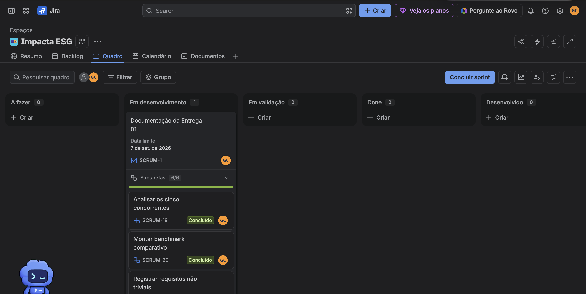
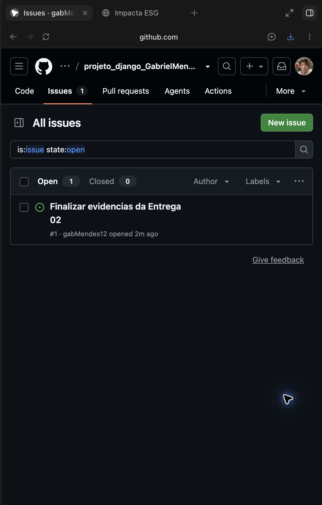
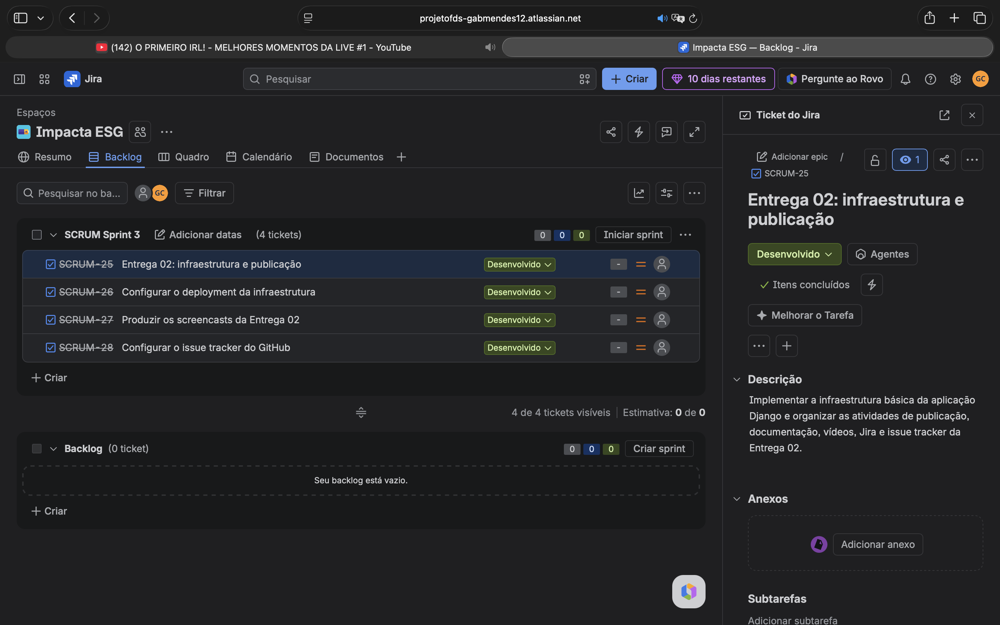

# Impacta ESG

Aplicação web para ajudar pequenas e médias empresas a dar os primeiros passos em ESG e acompanhar os resultados das ações escolhidas.

> Projeto da disciplina Fundamentos de Desenvolvimento de Software, turma 2026.2.

## O problema

Muitas PMEs sabem que ESG é importante, mas não sabem por onde começar. Também é difícil relacionar uma prática a um resultado da empresa. O desafio proposto pela Deloitte é tornar o tema mais simples e mostrar que ações ambientais, sociais e de governança podem trazer benefícios concretos.

## A solução

Nossa proposta reúne um diagnóstico curto, um plano de ação e indicadores simples. A pessoa responsável pela empresa consegue ver o que precisa de atenção, escolher uma ação e acompanhar sua evolução sem depender de uma equipe exclusiva de sustentabilidade.

## Tecnologias previstas

- Python 3.9+
- Django 4.1
- SQLite durante o desenvolvimento e banco relacional em produção
- HTML, CSS e JavaScript

## Exemplo Django aplicado

O projeto também segue o exemplo prático do professor com um fórum simples
para compartilhar dúvidas e respostas sobre ESG.

- Lista de perguntas: `/forum/`
- Detalhe de uma pergunta: `/forum/1/`
- Nova pergunta: `/forum/inserir/`
- Nova resposta: `/forum/1/resposta/`
- Página inicial da proposta ESG: `/impacta/`
- Página Equipe: `/impacta/equipe/`
- Página Fale Conosco: `/impacta/fale-conosco/`

As tabelas do fórum são criadas com `python manage.py migrate`.

## Como executar localmente

1. Crie e ative um ambiente virtual Python.
2. Instale as dependências com `pip install -r requirements.txt`.
3. Execute `python manage.py migrate`.
4. Inicie a aplicação com `python manage.py runserver`.
5. Acesse `http://127.0.0.1:8000/`.

## Equipe

| Nome completo | E-mail CESAR School |
| --- | --- |
| Gabriel Mendes Cavalcanti | gmc3@cesar.school |

> A equipe registrada nesta etapa está listada acima.

## Entrega 01: análise e planejamento

- [x] [Análise de competidores](docs/analise-de-competidores.md)
- [x] [Evidências visuais dos competidores](docs/evidencias/competidores)
- [x] [Requisitos não triviais](docs/requisitos.md)
- [x] [Histórias de usuário em BDD](docs/historias-de-usuario.md)
- [x] [Plano da Sprint 01](docs/plano-de-sprints.md)
- [x] [Quadro da Sprint 01 no Jira](https://projetofds-gabmendes12.atlassian.net/jira/software/projects/SCRUM/boards/1)
- [x] Print do quadro da Sprint 01 no README

### Quadro da Sprint 01

## Entrega 02: infraestrutura e publicação

- [x] Infraestrutura básica da aplicação Django
- [x] Deployment da infraestrutura em produção
- [x] Link e instruções de acesso ao ambiente publicado
- [x] Screencast de uso do sistema no README
- [x] Screencast de explicação do código Django no README
- [x] [Sprint 02 criada e atualizada no Jira](https://projetofds-gabmendes12.atlassian.net/jira/software/projects/SCRUM/boards/1/backlog)
- [x] Print do quadro da Sprint 02 no README
- [x] [Issue/bug tracker do GitHub em uso](https://github.com/gabMendes12/projeto_django_GabrielMendes_2a/issues/1)
- [x] Print do issue/bug tracker no README

### Aplicação publicada

A aplicação está disponível em [projeto-django-gabriel-mendes-2a.vercel.app](https://projeto-django-gabriel-mendes-2a.vercel.app/).

Para acessar, basta abrir o link. O projeto está conectado ao GitHub e novos
commits na branch `main` geram uma nova publicação na Vercel.

### Screencasts da Entrega 02

- [Demonstração de uso do sistema](https://youtu.be/KMuzSCL4ZfQ?si=qFBmC-s2jiPuku8t)
- [Explicação do código e do fluxo Django](https://youtu.be/HdCmk_b3J_k?si=3WZL3p3dH3ISatT9)

### Quadro atualizado da Entrega 02

### Issue tracker

## Entrega 03: histórias e evolução do produto

- [x] [Seis histórias de usuário com cenários BDD](docs/historias-entrega-03.md)
- [x] Seleção de três histórias para implementação
- [x] Sprint 03 criada no Jira
- [x] Print inicial do backlog da Sprint 03 no README
- [ ] Deployment das histórias atualizado
- [ ] Screencast de uso das histórias no README
- [x] Issue/bug tracker atualizado com três itens
- [ ] Print do issue tracker atualizado no README
- [ ] Screencast de explicação do código Django no README
- [ ] Print final do quadro da Sprint 03 no README

### Histórias implementadas

**US01 — Enviar mensagem de contato**

Como pessoa interessada no Impacta ESG, quero enviar uma mensagem pela página
Fale Conosco para tirar uma dúvida ou sugerir uma melhoria. O formulário valida
os campos, registra mensagens válidas e confirma o envio.

**US02 — Consultar a equipe**

Como pessoa visitante, quero consultar a página Equipe para saber quem
participa da construção do Impacta ESG. A página apresenta o integrante, sua
atuação e um meio de contato cadastrados no banco de dados.

**US03 — Pesquisar perguntas no fórum**

Como pessoa responsável por uma PME, quero pesquisar perguntas no fórum para
encontrar orientações sobre um tema ESG específico. A busca filtra título e
descrição e apresenta feedback quando nenhum termo é informado.

### Issue tracker atualizado

Foram registrados os itens de acompanhamento da Entrega 03 no GitHub:

- [#2 — Persistir mensagens de contato em produção](https://github.com/gabMendes12/projeto_django_GabrielMendes_2a/issues/2)
- [#3 — Exibir feedback quando a busca não encontra perguntas](https://github.com/gabMendes12/projeto_django_GabrielMendes_2a/issues/3)
- [#4 — Confirmar o recebimento de mensagens de contato](https://github.com/gabMendes12/projeto_django_GabrielMendes_2a/issues/4)

### Backlog inicial da Sprint 03

## Situação atual

O repositório contém a infraestrutura inicial da aplicação Django, o fórum de
perguntas e as funcionalidades em desenvolvimento da Entrega 03: página
Equipe, Fale Conosco e pesquisa de perguntas. As evidências pendentes da etapa
são os vídeos, o print do issue tracker e o quadro final da Sprint 03.

## Membros anteriores

| Nome | E-mail CESAR School | Entrada | Saída |
| --- | --- | --- | --- |
| Não se aplica até o momento | Não se aplica | Não se aplica | Não se aplica |
